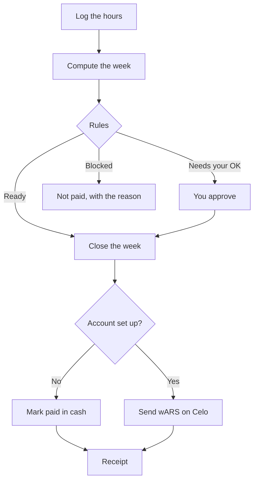
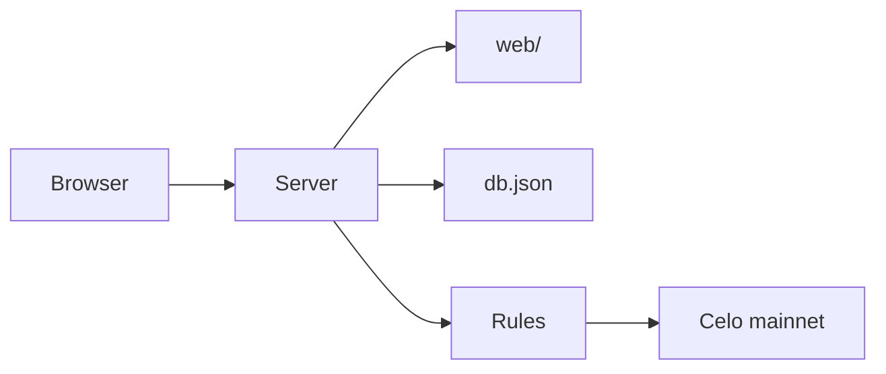

# Sueldo

Weekly pay for a small shop. The owner logs the hours, sees what each person is owed, and closes the week. Amounts stay in pesos.

Sueldo is one business, one page, and a file for the accountant. It does not ask the owner to learn a wallet.

Author: Sithu Nyein · [sithunyein.mailto@gmail.com](mailto:sithunyein.mailto@gmail.com)

## The problem

A bakery, kiosk, or workshop with a few people pays wages in cash every week. That means counting bills, getting change, writing a receipt by hand, and keeping a pile of paper that has to match the accountant at the end of the month.

If the owner is away on Friday, payday slips. If someone needs money on Saturday, the owner hands over cash and the count breaks.

A normal payroll service wants a bank account, a formal contract, and a monthly fee, then pays into bank accounts that many of the staff do not have.

Sueldo replaces the pile of paper. The owner still decides the rules. The page shows why a person is ready, waiting, or not paid, before any money moves.

## How it works



1. **Create the business.** Name, your name, city. One business on the page.
2. **Add a person.** Name, job, pay per hour, and a monthly limit. A pay account is optional.
3. **Log hours.** Half hours, and only days in the current week. The week runs Monday to Sunday, Argentina time.
4. **Read the week.** Each person is ready, needs your OK, or is not paid. The reason is on the line.
5. **Close it.** You confirm first. If no pay account is set up, this writes the week as paid in cash. You still hand over the pesos. If an account is set up and funded, each ready line is one wARS transfer on Celo mainnet.
6. **Keep the receipt.** Name, hours, amount, and date. Download the month as a file for the accountant.

A payment that needs your OK is not marked paid. A person already paid this week is not paid again.

### Rules

| Code | What it checks | Result |
| --- | --- | --- |
| `G_HORAS` | More hours than the week allows | Not paid |
| `G_DUPLICADO` | This person was already paid this week | Not paid |
| `G_TOPE_TRABAJADOR` | Over that person's monthly limit | Not paid |
| `G_TOPE_NEGOCIO` | Over the shop's monthly limit | Not paid |
| `G_FONDOS` | The account cannot cover this pay | Not paid |
| `G_BILLETERA` | The pay account is missing or not valid | Not paid |
| `G_ANOMALIA` | Hours are far above that person's usual week | Needs your OK |
| `G_APROBACION` | The amount is above the limit you set | Needs your OK |
| `W_INACTIVE`, `W_SIN_HORAS`, `W_SIN_MONTO` | Nothing to pay | Skipped |

A line that cannot be paid is never left waiting for an OK. Money is stored as integer centavos, so totals do not drift.

`G_FONDOS` and `G_BILLETERA` apply only when a pay account is set up. In the cash book they are skipped, because you hand over the pesos yourself.

### Two ways to pay

| | Cash book | Account |
| --- | --- | --- |
| When | No `AGENT_KEY` | `AGENT_KEY` is set and the wallet holds wARS |
| What "close the week" does | Writes the week as paid | Sends wARS, one transfer per person |
| What the worker gets | The cash you hand them, and a receipt | A receipt, and a cash-out link when a pay account is saved |
| What it does not do | It does not send money | It does not invent a payment if the transfer fails |

wARS on Celo is one peso per token. The page still shows pesos.

## Languages

English and Spanish. Use **EN** or **ES** in the bar. The choice is saved in the browser and covers the home page, the week, the dialogs, the reasons, and the month file.

## Project structure

```
sueldo/
├── api/index.ts          Vercel entry. Re-exports the server.
├── src/
│   ├── server.ts         HTTP API and pages
│   ├── payroll.ts        The week, the run, the receipts
│   ├── guardrails.ts     The rules
│   ├── money.ts          Centavos, wARS, amount parsing
│   ├── period.ts         Argentina week and month
│   ├── chain.ts          Celo reads and transfers
│   ├── store.ts          The book, one JSON file
│   ├── lang.ts           English and Spanish messages
│   └── config.ts         Environment
├── web/                  Pages, styles, and the client
├── test/                 Rules, money, periods
├── scripts/              Wallet, smoke check, swap
├── vercel.json
├── LICENSE
├── SECURITY.md
└── CODE_OF_CONDUCT.md
```



## Run it

```bash
npm install
npm start
```

Open [http://localhost:3000](http://localhost:3000). The first visit asks you to create the business. There is no sample shop.

```bash
npm test
npm run typecheck
```

Copy `.env.example` to `.env` only when you want the account path.

| Variable | What it does |
| --- | --- |
| `AGENT_KEY` | Signs transfers. Leave it unset to use the cash book. |
| `RPC_URL` | Celo node. Default is `https://forno.celo.org`. |
| `DATA_DIR` | Where `db.json` is stored. Default `.data`. |
| `PORT` | Default `3000`. |
| `AGENT_SCHEDULE` | `1` runs the Friday 18:00 Argentina pay while the process stays up. |
| `PUBLIC_URL` | Public address of this app, used on the agent card. |
| `FEE_CURRENCY` | `USDC` or `CELO` for network fees. |
| `ATTRIBUTION_TAG` | Code attached to each on-chain payment. |

`npm run wallet` prints a new key. Fund it with wARS for wages and a little USDC or CELO for fees before you turn the account path on.

## Deploy on Vercel

The repo is ready to import. You connect the account and push the code yourself.

1. Create a GitHub repository and push this project. Do not commit `.env` or `.data`.
2. In Vercel, choose **Add New Project** and import that repository.
3. Framework preset: **Other**. Leave the output directory empty. `vercel.json` already routes every path to the server.
4. Add environment variables only if you need them. For a cash book, none are required. For on-chain pay, set `AGENT_KEY`, `RPC_URL`, and `PUBLIC_URL`. Set `AGENT_SCHEDULE=0` on Vercel. The function does not stay awake, so Friday does not run by itself there.
5. Deploy.

On Vercel the book is stored in `/tmp`. A cold start can wipe it. A shop that must keep its history should run `npm start` on a host with a disk and set `DATA_DIR` to a persistent folder.

## Security

There is no login. Whoever can open the site can edit the book. Do not publish the URL until you are ready for that, or put it behind a private network.

`AGENT_KEY` never goes to the browser. See [SECURITY.md](SECURITY.md).

## License

[MIT](LICENSE) © Sithu Nyein

## Conduct

See [CODE_OF_CONDUCT.md](CODE_OF_CONDUCT.md). Questions and reports go to [sithunyein.mailto@gmail.com](mailto:sithunyein.mailto@gmail.com).
